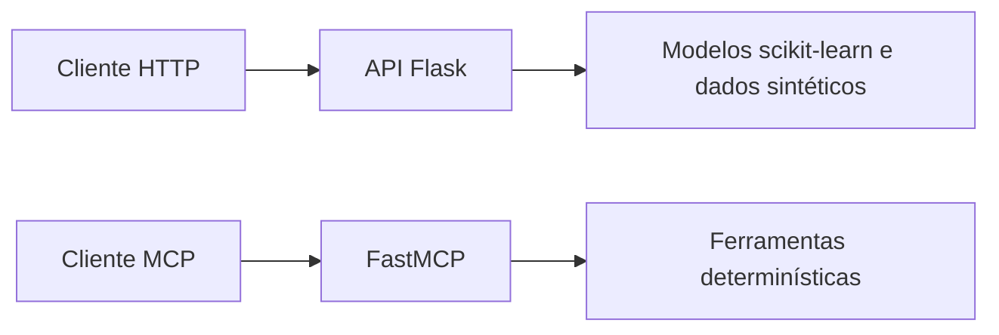

 |  | 

# Oráculo X-37 — API e Ferramentas MCP

## Visão geral

Fatos verificáveis no código: repositório Python com API Flask para treinar e servir modelos scikit-learn de classificação e regressão, além de servidor FastMCP separado com ferramentas determinísticas para simulação exploratória, explicação de previsões, auditoria descritiva, monitoramento por limiares e comparação ponderada de opções. O README também apresenta objetivos de soberania tecnológica, IA e blockchain e descreve usos estratégicos, mas essas alegações não são demonstradas por integrações, dados ou validações no código inspecionado. O serviço gera dados sintéticos de treino.

## Objetivo e valor

**Problema/escopo:** API Python de classificação e regressão com scikit-learn e servidor MCP com ferramentas determinísticas de análise explicável.

**Valor verificável hoje:** o repositório torna explícitos seus artefatos, interfaces e limitações para que mantenedores e contribuidores possam avaliar o que existe sem confundir demonstração, proposta e produção.

## Arquitetura e tecnologias

Parcialmente inferível pela árvore, mas não documentada formalmente: app/main.py cria a aplicação Flask e registra app/api/routes.py; app/services/oracle_service.py encapsula treinamento, predição e explicação, app/models/model_loader.py lida com serialização, e app/core/config.py concentra configuração. app/mcp/server.py é servidor MCP separado. Há modelos .pkl em models/, script de treino em scripts/train.py e testes em tests/. README não explica fronteiras ou integração entre API, modelos e MCP; docs/mcp-integration-findings.md contém afirmações que não correspondem integralmente aos arquivos atuais.

- Python (linguagem indicada pelo GitHub e pelos arquivos).
- API Flask; scikit-learn com RandomForestClassifier/RandomForestRegressor, NumPy e SHAP no serviço de modelos.
- Servidor MCP via FastMCP; ferramentas implementadas em app/mcp/server.py.
- Configuração usa python-dotenv; testes escritos para pytest; há Dockerfile e docker-compose.yml.
- Manifestos também declaram pandas, matplotlib, FastAPI, Uvicorn e Gunicorn, mas isso não comprova uso efetivo no código inspecionado; as rotas da API importam Flask.
- Há divergências de versões entre requirements.txt e pyproject.toml; CI usa Python 3.10 e Dockerfile parte de Python 3.11.

## Início rápido

Os comandos abaixo refletem instruções, manifestos ou pontos de entrada presentes no repositório. Dependências externas, segredos e serviços estão indicados quando aplicável; a presença de um comando não equivale a uma execução validada.

1. README documenta a instalação com pip install -r requirements.txt.
2. README documenta python app/mcp/server.py para iniciar o servidor MCP; declara transporte padrão stdio e seleção de sse com ORACULO_X37_TRANSPORT=sse.
3. Workflow .github/workflows/python-app.yml instala requirements.txt, executa verificações flake8 e chama pytest em pushes e pull requests para main; isso comprova comandos configurados, não que passem.
4. Não executei comandos. A instalação limpa indicada no README não está comprovada como funcional: requirements.txt não declara Flask, embora a API e seus testes o importem.

## Exemplo de uso

Exemplo existente em tests/test_api.py: POST /api/v1/classification/train com n_samples igual a 50; em seguida POST /api/v1/classification/predict com data contendo uma linha de dez valores decimais. O teste também chama GET /api/v1/health. São rotas e sequência baseadas no código/testes; README não documenta comando verificado para iniciar a API Flask e as chamadas não há execução validada registrada.

## Estado e limitações

**Maturidade indicada:** Demonstração.

- Não tratar como capacidades comprovadas as alegações do README sobre segurança nacional, alto nível, independência de infraestrutura estrangeira, soberania de dados ou blockchain: os arquivos examinados não as demonstram.
- Há incompatibilidade aparente de dependências: API e tests/test_api.py importam Flask, ausente de requirements.txt e da lista do pyproject.toml; em contraste, o manifesto declara FastAPI, que não aparece nas rotas inspecionadas. Instalação/testes limpos podem falhar; não foram executados.
- requirements.txt fixa versões diferentes das faixas em pyproject.toml. O manifesto diz Python >=3.7, mas server.py usa sintaxe de união de tipos com |, incompatível com versões anteriores a Python 3.10.
- O próprio código qualifica a simulação como exploratória, não causal ou probabilística calibrada; não inferir previsões operacionais ou validação de modelos. O código exige revisão humana.

## Contribuição

Leia [CONTRIBUTING.md](CONTRIBUTING.md) antes de abrir uma issue ou pull request. Para reportes de segurança, siga a orientação específica do repositório, se houver.

## Licença

Este repositório está licenciado sob **MIT**; consulte [LICENSE](LICENSE).

## Patrocínio e apoio

O desenvolvimento aberto exige tempo para manutenção, documentação, testes, revisão de contribuições e resposta a issues. Se este projeto for útil, considere apoiar a continuidade pelo [GitHub Sponsors](https://github.com/sponsors/felipetjmg1-bit). O apoio não representa promessa de funcionalidades, prazo de entrega ou suporte comercial.

