# Oráculo X-37

<p align="center">
  
</p>

**Aplicação demonstrativa em desenvolvimento e validação.** O Oráculo X-37 reúne uma API Flask para treinamento e inferência de modelos scikit-learn e um servidor MCP independente com ferramentas determinísticas de análise. Não é um sistema de produção nem um serviço de decisão automatizada validado.

## Visão geral

O projeto explora uma arquitetura modular para:
- treinamento demonstrativo com dados sintéticos;
- inferência de modelos de classificação e regressão;
- rotas de explicação e inspeção de resultados;
- ferramentas MCP para simulação exploratória, explicação, auditoria descritiva, monitoramento por limiares e apoio estruturado à comparação de opções.

A API HTTP e o servidor MCP são processos separados. Não presuma que o servidor MCP esteja embutido na API Flask.

## Arquitetura

| Componente | Localização | Função |
|---|---|---|
| API Flask | `app/main.py`, `app/api/` | Endpoints HTTP |
| Serviços de ML | `app/services/`, `app/models/` | Treinamento e inferência |
| Servidor MCP | `app/mcp/server.py` | Ferramentas via MCP |
| Treinamento | `scripts/train.py` | Geração e treinamento demonstrativo |
| Testes | `tests/` | Verificações automatizadas |

## Executar localmente

Requisitos: Python 3.10 ou superior.

```bash
git clone https://github.com/felipetjmg1-bit/oraculo-x37.git
cd oraculo-x37
python -m venv .venv
source .venv/bin/activate  # Windows: .venv\Scripts\activate
python -m pip install --upgrade pip
python -m pip install -r requirements.txt
python -m app.main
```

A API utiliza a porta 5000 por padrão. Consulte `.env.example` e `app/core/config.py` para as variáveis disponíveis.

## Verificar a API

```bash
curl http://127.0.0.1:5000/api/v1/health
```

Exemplo de treinamento com dados sintéticos:

```bash
curl -X POST http://127.0.0.1:5000/api/v1/classification/train \
  -H "Content-Type: application/json" \
  -d '{"n_samples": 50, "n_features": 10, "test_size": 0.2}'
```

Os dados e resultados de exemplo são demonstrativos. Não representam desempenho validado em dados reais.

## Servidor MCP

O servidor MCP é iniciado separadamente:

```bash
python app/mcp/server.py
```

Os testes atuais exercitam diretamente as funções do módulo. Para declarar interoperabilidade ponta a ponta, ainda é necessário validar handshake e invocação por um cliente MCP real e pelo transporte configurado.

## Testes

```bash
python -m pytest -q
```

O workflow de runtime instala as dependências, executa os testes, inicia a API e registra respostas HTTP reais no ambiente de CI. Consulte [RUNTIME-EVIDENCE](docs/RUNTIME-EVIDENCE.md) e [MCP-VALIDATION](docs/MCP-VALIDATION.md).

## Publicação

O Netlify publica somente a apresentação estática em `site/`. A API Flask e o servidor MCP não são executados pelo Netlify. Consulte [NETLIFY-DEPLOYMENT](docs/NETLIFY-DEPLOYMENT.md) para a separação entre apresentação e backend.

## Segurança e limitações

- Não exponha a API diretamente à internet sem autenticação, autorização, TLS, rate limiting, validação de entrada e revisão de segurança.
- Não envie dados pessoais, sensíveis ou sigilosos; use dados sintéticos ou anonimizados.
- Resultados de treinamento sintético não demonstram generalização.
- Explicações de modelos não equivalem a causalidade ou validação científica.
- Trate arquivos pickle como artefatos confiáveis somente após verificar origem e integridade.
- Para uso sujeito à LGPD, documente finalidade, base legal, minimização, retenção, controle de acesso e revisão humana.

## Licença

MIT. Consulte [LICENSE](LICENSE).

---

**Responsável pelo projeto:** Impulso Digital Soluções em IA.
